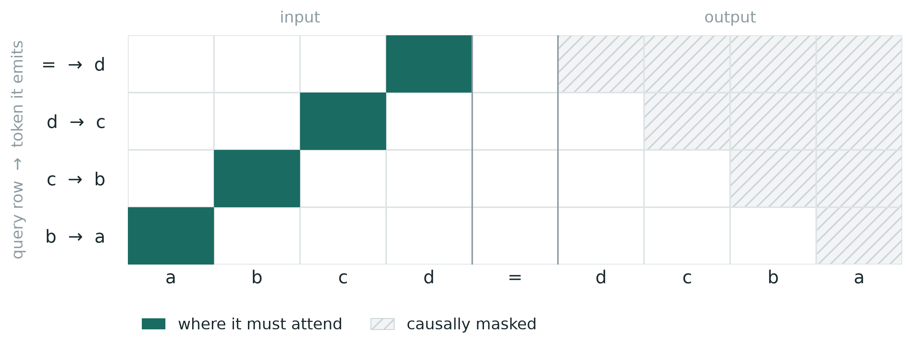
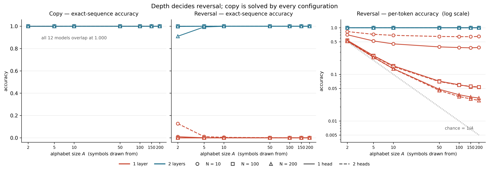
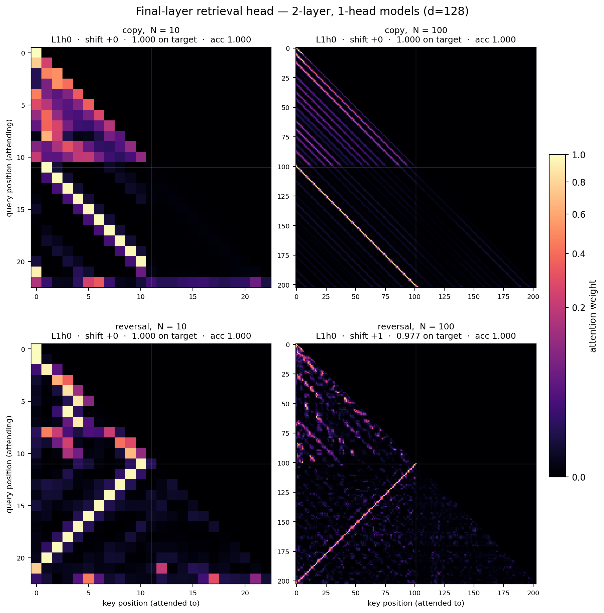

## What is string reversal?
For some time I have been playing around with this string reversal task where the inputs look like this:
```
abcd=dcba
```
The task is to predict the reversed string `dcba` given the the input string `abcd`. The network learns to predict this for arbitrary input strings.

It seems trivial but to be able to generalise this task, the network needs to learn the following attention pattern in one of his attention heads: 



In particular, the output token `=` has to attend to the input token `d`, output token `d` has to attend to input token `c` and so on. This forms an anti-diagonal shape in the attention head scores matrix.

### Is this anti-diagonal necessary to solve the task for arbitrary Transformer model?
The attention module is the only Transformer component that allows information from other tokens to mix. This task heavily depends on previous tokens. The model cannot solve it without looking to the past at exactly these tokens. In reality, the transformer could split the pattern between multiple heads and layers, however, there must exist a subset of heads that together compose this exact pattern. Since the information about the next token flows strictly from the past tokens highlighted in the image above. 

## Motivation

I find this anti-diagonal pattern quite fascinating. In my previous work[^1], I observed that pre-trained models possess a limited capability to represent this pattern and solve the reversal task. Intuitively, it is because this anti-diagonal attention pattern cannot be natively modelled by RoPE. However, this means that the model is able to process positional information that is beyond RoPE. I posit that absolute positional information must leak into the residual stream and flow into the MLP layers which solve the positional task to be able to form the anti-diagonal pattern in a following attention layer. I'm interested in analyzing the exact mechanisms of the leakage and the dynamics in the MLP layer and trying to transfer that to general pre-trained LLMs and see if we can detect similar mechanisms also there.

In the next part we will be training a model from scratch to do this task and analyzing it's weights.
## Methodology
I train a *Qwen3* type of Transformer architecture across multiple hyperparameter settings: `d_model = {128}, num_heads = {1, 2}, n_layers = {1, 2}` and training sequence length `N = {10, 100, 200}`. For the copy task, he input sequences are of the following form:

```
[BOS][char_1][char_2]...[char_N][SEP][char_1][char_2]...[char_N][EOS]
```
For the reversal task, the input sequences are the following:
```
[BOS][char_1][char_2]...[char_N][SEP][char_N]...[char_2][char_1][EOS]
```

The sequences start with a BOS token, followed by N character tokens, a separator token `[SEP]`, followed by the same exact sequence of character tokens, either in the original order for the *copy task* or in the reversed order for the *reversal task*. 

I initialize the vocabulary with 256 unique character tokens. For a single training run, the sequence length $N$ is fixed. We sample a random subset of characters from the vocabulary. These are used as the alphabet for the sequence. The size of the subset is uniformly sampled from $[1, seq\_len]$ . I constrain the alphabet size to make sure there are characters that repeat in the input sequence. This makes the task harder because the network needs to learn to disambiguate between the identical tokens at different positions. I train these models using AdamW until for a maximum of 80 000 steps. (See more details on hyperparameters in the code.)

## Results
### Do any of the architectural hyperparameters (`d_model`, `num_heads`, `n_layers`, training sequence length `N`) affect how well the model can fit the training data?



I compare the in-distribution accuracy scores on unseen samples across different architecture hyperparameters and alphabet sizes. For the copy tasks, even the 1-layer model with a single head fits the task easily. For reversal, it seems that 2 Transformer layers are necessary to even the even fit the tasks. 1-layer models struggle and stay barely above random guessing. While the 2-layer models fit perfectly no matter the other hyperparameters.



All of the trained models copy models and all the 2-layer reversal models fit the expected diagonal (copy) or anti-diagonal (reversal) attention pattern.

### Does absolute positional information leak into the residual stream? Is absolute position decodable from the residual stream?
I train an array of linear classifier probes (multinomial logistic regression) on various layers and components to predict the absolute position of the current token (from index 0, index 1 up to the last token index `N`).


Inspired by [^2], we measure absolute-position leakage in attention pre-softmax scores as the following:
$$\Delta R^2 = R^2_{\text{full}} - R^2_{\text{base}}$$
Where $R^2_{\text{base}}$ is saturated relative-offset baseline. The baseline is a linear model predicting $ℓ_{i​j}=f⁡(i−j)+ε$ with $f$ fit as one free parameter per distinct value of $i−j$. The full model adds mean-centered $i$ and $j$ as continuous predictors. We compute the leakage metric on the layer 2 heads of all copy and reversal models. Values are the maximum over final-layer heads; permutation p-values (500 resamples) in parentheses. Below you can see the results:

| $N$ |  copy, 1 head | copy, 2 heads |  reversal, 1 head | reversal, 2 heads |
| --: | ------------: | ------------: | ----------------: | ----------------: |
|  10 | 0.0033 (.052) | 0.0017 (.006) | **0.0620** (.002) | **0.0473** (.002) |
| 100 | 0.0000 (.020) | 0.0001 (.002) | **0.0035** (.002) | **0.0099** (.002) |
| 200 | 0.0000 (.862) | 0.0000 (.305) | **0.0042** (.002) | **0.0051** (.002) |


[^1]: [Attend or Perish: Benchmarking Attention on Algorithmic Reasoning](https://aclanthology.org/2026.blackboxnlp-1.41.pdf) (Spiegel et al., 2026) 
[^2]: [Where does Absolute Position come from in decoder-only Transformers?](https://arxiv.org/abs/2606.06160)(Ruscio et al., 2026)